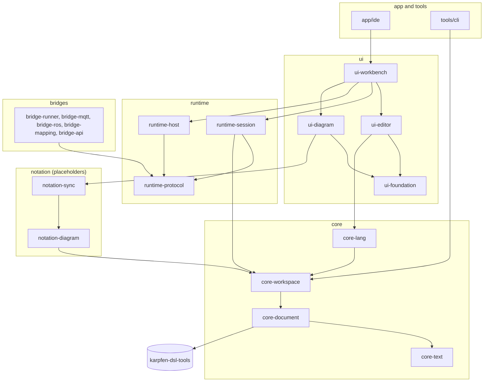

# Architecture

This document is a map of the karpfen IDE code base. It names the modules, says what each one is for, how they depend
on each other and which types to read first. The details live in the KDoc of the types it names. Search for a type
name to find its file. How to build and run the IDE is in the [README](../README.md) and the
[getting started guide](getting-started.md). Design decisions and behaviour worth knowing are in the
[developer notes](devdoc.md).

## The IDE and the repositories it builds on

karpfen IDE is a desktop IDE for the karpfen modeling languages. KMeta files (`.kmeta`) hold metamodels, KModel files
(`.kmodel`) hold models, and KStates files (`.kstates`) hold hierarchical state machines with Python in their `EVAL`
blocks. Environment descriptors (`*.kenv.json`) tie these files together for a run. The IDE is a Gradle build of
Kotlin/JVM modules, and its user interface uses Compose Multiplatform for Desktop. It builds on two other
repositories. Both are git submodules of this one.

- **karpfen-dsl-tools**, in the directory `karpfen-dsl-tools`, is the language library. It holds the grammars, the
  lexers and parsers that ANTLR generates from them, the readers that turn text into semantic models with diagnostics,
  and the semantic model in the packages `io.karpfen.dsl.meta`, `io.karpfen.dsl.instance` and `io.karpfen.dsl.states`.
  The IDE has no grammar of its own for the modeling languages. `settings.gradle.kts` includes the submodule as a
  composite build and substitutes it for the module `io.karpfen:karpfen-dsl-tools`, so a change that spans both
  repositories is one local build. A blank `dslToolsPath` property switches to artifact mode instead. That mode
  resolves the version named in `gradle/libs.versions.toml` from GitHub Packages and needs credentials. The IDE needs
  dsl-tools 2.0 or newer, and the settings stop the build with a clear message when the checkout is older.
- **karpfen-runtime**, in the directory `karpfen-runtime`, is the execution server. It runs environments made of a
  metamodel, a model and state machines, and it offers an HTTP API and a WebSocket. The submodule points at the
  runtime's branch with IDE support. The runtime is not part of the Gradle build. The build uses its checkout in three
  places. The task `bundleRuntimeSources` of runtime-host packs the files git tracks there into the module's
  resources, and the IDE builds its runtime Docker image from them. The tests of runtime-protocol compare the client
  with the runtime's own sources. The script `runtime/live-runtime.sh` builds the runtime as a Docker image for the
  live tests. The runtime has a nested dsl-tools submodule of its own, so a clone needs `--recurse-submodules`.

## Modules and layers

The modules are grouped by layer into directories. A module's Gradle path mirrors its directory, so `core/core-text`
is `:core:core-text`. All code of a module lives below one package prefix made of `io.karpfen.ide`, the group and the
rest of the module name. For example, core-document uses `io.karpfen.ide.core.document`. Three modules use shorter
prefixes: app/ide uses `io.karpfen.ide.app`, architecture-tests uses `io.karpfen.ide.architecture` and build-logic
uses `io.karpfen.ide.buildlogic`.

| Group | Modules | What it is |
|---|---|---|
| core | core-text, core-document, core-workspace, core-lang | The language core. It knows nothing about a UI. |
| runtime | runtime-protocol, runtime-session, runtime-host | The IDE's side of the karpfen runtime. No UI either. |
| ui | ui-foundation, ui-editor, ui-workbench, ui-diagram | The user interface, built with Compose. |
| app | app/ide | The desktop application and its composition root. |
| tools | tools/cli | The `karpfen` command-line tool. |
| notation | notation-diagram, notation-sync | The diagrams without their UI: model, layout and the step from text to diagram. |
| bridges | bridge-api, bridge-mapping, bridge-mqtt, bridge-ros, bridge-runner | Connect a running model to external systems. Only the shared core exists. |
| build tooling | build-logic, architecture-tests | Convention plugins, dependency rules, architecture tests. |

Next to the modules, the folder `examples` holds the lamp model of the getting started guide, and the script
`runtime/live-runtime.sh` runs a runtime in Docker for the live tests.

Dependencies only point downwards. The build allows these project dependencies and no others:

- A core module may depend on other core modules only.
- A notation module may depend on core and notation.
- runtime-protocol depends on no other module. The bridges build on it, so it must stay free of the core.
- runtime-session and runtime-host may depend on core and runtime.
- A bridge may depend on core, other bridges and runtime-protocol. The rest of the runtime is off limits.
- A UI module may depend on core, notation, runtime, bridges and other UI modules.
- tools/cli may depend on core, notation, runtime and bridges, but not on the UI or the app.
- app/ide may depend on every module.
- architecture-tests depends on no module. It reads the sources of all modules from disk.

Two more rules cut across the groups. Only the ui and app modules may use Compose, AWT or Swing, so everything else
stays UI-agnostic and runs in tests without a window. The core, notation and runtime modules compile in Kotlin's
explicit API mode, so every public declaration there is deliberate.

The diagram shows the main dependencies. It leaves out edges that a module also reaches through another one, such as
ui-workbench to core-lang, which it also gets through ui-editor.

## The modules

### core-text

The text of one document. `EditableText` applies edits atomically, keeps the undo history with typing coalescing
through its `UndoManager`, and publishes each new immutable `TextSnapshot` together with a `TextChange` as flows.
`LineIndex` maps offsets to lines and columns. `EditableText.mapOffset` and `EditableText.mapRange` carry positions
from an older version onto the current text, which every layer uses to keep carets, highlights and diagnostics in
place while the user types. Start at `EditableText`, `TextSnapshot`, `TextEdit` and `EditOrigin`. It depends on
kotlinx-coroutines only and is used by core-document and everything above it.

### core-document

Turns the text of a document into tokens, a parse outcome and diagnostics. A `DocumentSession` in the package
`session` follows an `EditableText` with its `TokenizePipeline`, `ParseScheduler` and `DiagnosticsMerger`. Each
language plugs in through a `LanguageSupport`, and `defaultLanguageRegistry` in the package `registry` wires the three
modeling languages and environment descriptors. Only the package `antlr` uses ANTLR and the parsers that dsl-tools
generates. Only the package `dsl` uses the dsl-tools readers, and the rest of the IDE reaches them through
`DslReader`. Environment descriptors are read with the IDE's own tolerant JSON parser in the package `json`, and
`EnvironmentDescriptor` in the package `environment` is the one declaration of their shape. It depends on core-text,
karpfen-dsl-tools and kotlinx.serialization. Its test fixtures, such as `Examples` and `Mutations`, serve the tests of
many modules.

### core-workspace

An opened folder. `Workspace` is the facade over the file tree and its watcher in the package `files`, the open
documents with saving and reloading in `document`, the environment descriptors in `environment`, the modeling contexts
in `context`, the dsl-tools analysis of every context in `analysis` and the problems of every file in `problems`.
`WorkspaceFactory` is the seam through which the workbench and the command-line tool open folders. Start at
`Workspace`, then read `ContextResolver`, `ProjectAnalyzer` and `WorkspaceProblems`. It depends on core-document and
is used by core-lang, runtime-session, notation-diagram and tools/cli. Its test fixtures, `TestWorkspaces` and
`FakeFileWatcher`, open workspaces on virtual time.

### core-lang

The language services: highlighting, completion, go to definition, references, hover and bracket matching for the
three modeling languages and environment descriptors. `LanguageServices` is the facade for one workspace,
`LanguageDocument` is its immutable input, and `defaultLanguageServices` in the package `services` creates it over the
workspace's analysis. Each language contributes a `LanguageFeatures` family from the package `feature`, with its
providers in the packages `kmeta`, `kmodel`, `kstates` and `environment`. Shared mechanics live in the packages
`context`, `symbols`, `modelpath` and `navigation`, with `CaretContextDetector`, `TypeCatalog` and
`ModelPathResolver` as good entry points. It depends on core-workspace and is used by ui-editor and ui-workbench.

### runtime-protocol

The typed client of the karpfen runtime with IDE support. `RuntimeClient` checks a runtime, creates environments and
opens connections. `RuntimeEnvironment` in the package `lifecycle` is the handle of one environment and keeps its
phase on the client's side, and `RuntimeConnection` in the package `connection` is the authenticated push channel.
The package `catalogue` holds the runtime's routes, texts and wire names as data, and `message` reads the runtime's
JSON and decodes its pushes. `RuntimeApi` in the package `api` is the raw gateway with one function per route, and its
results never throw. Only the package `transport.ktor` uses Ktor. The module depends on no other module of the
IDE. Its test fixtures hold `FakeRuntime`, which answers only what each test programs, `RuntimeGoldens` with the
runtime's wire format, and the scenarios that run against a real runtime.

### runtime-session

Deploys an environment descriptor of a workspace and keeps a session with the deployed environment. `RuntimeSessions`
prepares a deployment and launches a `RuntimeSession`. Preparing saves, awaits the analysis and plans with
`DeploymentPlanner` in the package `plan`. A session runs the deploy steps of the package `deploy`, observes the model
with the packages `observation`, `mirror` and `states`, and injects events with the package `events`. Inside a
session, `SessionConductor` carries out the commands one at a time and `PushRouter` is the only reader of the
connection's pushes. It depends on runtime-protocol and core-workspace and is used by ui-workbench. tools/cli
declares it as a dependency but does not use it yet.

### runtime-host

Runs or reaches the runtime of a workspace. `RuntimeHost` is that runtime with its status and log, and
`RuntimeHosts()` is the factory of the IDE's two hosts. `DockerRuntimeHost` runs a container the IDE owns, built from
the runtime sources bundled in the package `bundled`. `UrlRuntimeHost` attaches to a runtime started elsewhere. Only
the package `docker.engine` uses the Docker client, behind the port `DockerEngine`, and the whole public API stays in
the root package. It depends on runtime-protocol and is used by ui-workbench and app/ide.

### ui-foundation

The building blocks that the editor, the workbench and the application share. It knows no IDE feature. The package
`widgets` holds `TreeView` with `TreeNode`, `TabStrip` and `StatusBar`. The package `layout` holds `SplitPane` and
`ToolWindow`, `theme` holds `KarpfenTheme` and `icons` holds `KarpfenIcons`. `CommandRegistry` in `command` holds the
commands and menus. `KeyStroke`, `KeyShortcut` and `HostPlatform` in `keys` are the key model, and `keys.compose`
converts Compose key events into it. It depends on no other module and is used by every other UI module.

### ui-editor

The custom code editor. The `model` packages are free of Compose: editor actions and the keymap in `model.action`,
carets in `model.caret`, completion in `model.completion`, find and replace in `model.find` and go to line in
`model.navigation`. `CodeEditorState` in the package `state` is the state holder of one editor, and
`DefaultCodeEditorState` lists its collaborators, such as `ActionRunner` and `HighlightPipeline`. The package `view`
holds the composable `CodeEditor` with `EditorTextArea` and its painters, and `popup` holds the completion list, find
bar, go to line and hover. View and popups meet only through the slots of `EditorOverlays` in the package `overlay`.
It depends on ui-foundation and core-lang and is used by ui-workbench.

### ui-workbench

The content of the IDE window. `WorkbenchState` in the package `state` is the mediator that owns the opened workspace
and its language services and coordinates the feature states. Each feature package, such as `projecttree`, `tabs`,
`outline`, `problems`, `statusbar`, `output` or `runtime`, holds a Compose-free state class and a `view` sub-package
with its composables. `RuntimeState` in the package `runtime` is the state of the Runtime tool window.
`WorkbenchServices` holds the collaborators, `defaultWorkbenchServices` is the production wiring, and the `Workbench`
composable lays out the window. It depends on ui-editor, ui-foundation, core-lang, runtime-session, runtime-host and
ui-diagram, and is used by app/ide.

### app/ide

The desktop application. `main` resolves the home directory and the launch options and starts `IdeApplication`, the
composition root, which wires everything by hand without a framework. `IdeMenus` lays out the menus over the
registered commands, `IdeWindow.kt` holds the window and `IdeRunState` shuts the runtime down when the window closes.
`CrashHandling` turns unexpected exceptions into a log entry and an error dialog. The package `logging` routes what
dsl-tools logs into the workbench's Language Tools Output, and `logback.xml` in the module's resources configures the
logging. It depends on ui-workbench and logback. Its build script also holds the packaging into dmg, msi and deb.

### tools/cli

The `karpfen` command-line tool. `KarpfenCli` parses the arguments with `CliArguments` and answers an exit status from
`ExitCodes`. `ValidateCommand` in the package `validate` opens a `Workspace` without watching, waits for the analysis
and reports `Workspace.problems` as text or JSON through `ReportFormatter`. It uses the same problems rule as the IDE,
so both always agree. It depends on core-workspace. The end-to-end tests of app/ide use it too.

### notation-diagram, notation-sync and ui-diagram

The diagrams. There are three: the statechart of a state machine file, the class diagram of a metamodel file and the
object diagram of a model file.

notation-diagram holds the diagrams without any UI. `StatechartProjection` derives a `StatechartDiagram` from the text
and the outline of a file, with the states, their nesting and the transitions. `MetamodelProjection` and
`ModelProjection` derive a `StructureDiagram` from the outline. That is a diagram of boxes with rows of text and of
links between them, and it serves both the class diagram and the object diagram, because the two look alike. A layout
says where the elements are drawn, in absolute positions: a `StatechartLayout` or a `StructureLayout`. Both are a
`DiagramLayout`, which is what a view needs to move a drawing and to find the element under the pointer.

A `DiagramArrangement` lays one kind of diagram out, `StatechartArrangement` and `StructureArrangement`. Each computes
a layout automatically through a layouter that hands the work to the Eclipse Layout Kernel, which stays behind
`ElkKernel`. Each also computes a layout from a `VisLayout`, the arrangement the user made by hand, and knows the
changes a user can make to it. `VisEditing` holds the changes of waypoints and bars that all diagrams share.

notation-sync keeps a diagram in step with its text and its files. A `DiagramTracker` derives the diagram again after
every change through a `DiagramProjection` and keeps the last one while the text has syntax errors, and `VisFiles` reads
and writes the companion file of an arrangement by hand.

ui-diagram draws. `DiagramPane` takes the document session of a file and a `DiagramKind` and shows the diagram on a
canvas that can be moved, zoomed and arranged. The canvas, `DiagramCanvas`, and `DiagramEditing`, which turns the
gestures into changes, are the same for every kind of diagram. `DiagramFaults` keeps a failure inside the view, so it
cannot stop the window. What differs sits in a `DiagramNotation`: the
projection, the arrangement and a `DiagramPainter`, which is `StatechartPainter` or `StructurePainter`. ui-workbench
shows the pane next to the editor or in its place, as the user chooses per file.

### bridge-api and bridge-mapping

The shared core of the bridges. A bridge connects one running environment to one external system, and these two modules
hold everything that does not depend on which system that is. bridge-api has the types: `BridgeConfig` with its inbound
and outbound routes and their `FlowPolicy`, the two sides a bridge stands between, which are `BridgeEndpoint` for the
external system and `ModelLink` for the environment, and the `Bridge` lifecycle with its `BridgeStatus`. It builds on
runtime-protocol and uses its events, pushes and JSON values directly. bridge-mapping makes a bridge work.
`BridgeConfigFile` reads and writes a bridge file, `Mappings` translates a message into an event and a report of the
model into a message, and `RoutedBridge` runs every route with a waiting line of its own. A new kind of bridge only
brings a `BridgeEndpoint`.

### Placeholders

bridge-mqtt, bridge-ros and bridge-runner have no code yet. Each holds one object or a `main` function, so the build
and its rules already know the module, and their dependencies are already declared. bridge-mqtt adds the HiveMQ client
and bridge-ros adds the Ktor client for rosbridge. bridge-runner is an application named `karpfen-bridge-runner` whose
`main` only prints its usage. The [developer notes](devdoc.md) describe how the diagrams and the bridges are meant to
work.

### build-logic

An included build with the convention plugins that every module applies. `karpfen.kotlin-jvm` is the base. It sets
JDK 21, JUnit with the tags that keep time-budget and live tests out of normal test runs, explicit API mode for core,
notation and runtime, and the task `verifyModuleDependencies`. The other plugins build on it.
`karpfen.kotlin-serialization` adds kotlinx.serialization, and `karpfen.compose` adds Compose and refuses any module
outside ui and app. `karpfen.application` serves tools/cli and bridge-runner, and `karpfen.live-runtime-test` adds
the opt-in task `liveRuntimeTest` to the runtime modules. Read `ModuleDependencyRules` for the dependency rules,
`TestTags` for the test tags and `BundleRuntimeSources` for packing the runtime sources. All library versions live in
`gradle/libs.versions.toml`.

### architecture-tests

Konsist tests that check the layers, the adapters of foreign APIs, the package layout and the documentation style on
every build. `KarpfenModules` is the module table they share. The module has one placeholder object in its production
code, and all rules live in its test sources.

## Main flows

### A keystroke becomes a highlighted, parsed and checked document

1. `ProxyTextInput` in ui-editor receives the input through a hidden text field, so every keyboard layout, dead key
   and input method reaches the editor. It hands key strokes to `CodeEditorState.handleKey` and committed text to
   `CodeEditorState.type`.
2. `DefaultCodeEditorState` turns both into editor actions. Typed text becomes `typeTextAction`. A key stroke is
   looked up in the `EditorKeymap` and runs one of the `defaultEditorActions`. Every action runs through
   `ActionRunner`.
3. The action edits the document's `EditableText` in core-text. It applies the edits atomically, records one undo step
   and publishes a new `TextSnapshot` with its `TextChange`.
4. The `DocumentSession` in core-document follows the text. `TokenizePipeline` tokenizes the new version at once with
   the language's `Tokenizer`. `ParseScheduler` parses after a short quiet time with the language's `DocumentParser`,
   which finds syntax errors, outline, references and folding regions but does not call the dsl-tools readers.
5. `HighlightPipeline` in ui-editor combines the new tokens with the latest parse through `LanguageServices.highlight`
   of core-lang and publishes highlight spans. While the parse lags behind, it keeps the semantic colours of the last
   result, mapped onto the new version.
6. `CodeEditor` draws the editor state. Its `EditorTextArea` paints with `TextAreaPainter`, which lays out the visible
   lines with `LineLayouter` and keeps them in a `LineLayoutCache`.
7. Meanwhile the `Workspace` in core-workspace sees the new text of the open document, and its `AnalysisScheduler`
   runs the project analysis again, as the next flow describes.
8. `ProjectDiagnosticsPublisher` pushes the analysis diagnostics of each open file into its session through
   `DocumentSession.setExternalDiagnostics`. The session merges them with its own diagnostics by `mergeDiagnostics`,
   and the editor underlines them.

### Opening a folder and building the project analysis

1. `WorkbenchState.openFolder` in ui-workbench hands the folder to `FolderFlow`. The flow checks that the folder can
   be listed, asks about unsaved changes, shuts down the old workspace's runtime and closes the old workspace.
2. `WorkspaceFactory.open` in core-workspace creates the `Workspace` in a coroutine scope of its own. The dispatcher
   of that scope, the UI thread in the IDE, is the single writer of every open document's text.
3. The folder flow then wires the workbench to the new workspace. `defaultLanguageServices` of core-lang creates its
   `LanguageServices`, `SubStateBindings` binds the feature states to it, and `RuntimeHolder` creates its
   `RuntimeState`. Last, the flow waits for the first scan, so the project tree is filled when the flow ends.
4. Inside the workspace, `TreeRefresher` scans the folder with `WorkspaceScanner` into a `WorkspaceTree`. Unless
   watching is off, it also follows changes on disk through a `FileWatcher`. `DiskSynchronizer` reloads an open
   document whose file changed, or reports a conflict when the document has unsaved edits or the file is gone.
5. `ContextTracker` reads the environment descriptors, or the editor text of a descriptor that is open, and lets
   `ContextResolver` derive the `ModelingContext`s. Each descriptor defines one context. Each directory without a
   descriptor forms one context of the karpfen files in it that no descriptor names. Files in no context are loose
   files. The result is `Workspace.contexts`.
6. `AnalysisScheduler` runs the `ProjectAnalyzer` after a quiet time whenever the contexts, a rescan or the text of an
   open document change, and cancels a run that is out of date. `DefaultProjectAnalyzer` reads each context through
   `DslReader` with `ContextReader`: the metamodel first, then the events file with the metamodel's types, each model
   against the metamodel and each state machine. A file is read only when its syntax is clean, and `RememberedReads`
   skips a file whose text and metamodel did not change. The result is a `ProjectAnalysis` in `Workspace.analysis`.
7. `ProjectDiagnosticsPublisher` puts the diagnostics of each analyzed file into its open session. `ProblemsPublisher`
   with `WorkspaceProblemsAggregator` publishes `Workspace.problems`, one rule for every diagnostic of every file. The
   Problems view, the status bar and `karpfen validate` all read this value.

### Running a model

1. Run in the Run menu, registered by `RuntimeCommands` in ui-workbench, calls `RuntimeState.run`.
   `DescriptorResolver` picks the environment descriptor: the one in the active editor, the only one of the folder, or
   one the user chooses. `RunSupport.saveAll` saves every open file, because a deployment uploads the saved files. A
   previous run of the same descriptor stops first.
2. `RuntimeSessions.prepare` in runtime-session hands the work to `DeploymentPreparer`. It saves every open document
   again, awaits the analysis, refuses files that still differ from their saved state, and plans with
   `DeploymentPlanner`, whose `PlanCheck`s block what the runtime would mishandle. It then turns the analysis into
   immutable values: the `TypeSchema` of the metamodel, the seed of the model from `MirrorSeeder`, one `MachineLayout`
   per state machine and the `EventCatalog` from `EventCatalogBuilder`. A blocked plan ends the run with its findings
   in the Runtime tool window.
3. `RuntimeHostBinding` asks the `RuntimeHost` of runtime-host for a runtime with `ensureRunning`.
   `DockerRuntimeHost` checks the local Docker engine and removes the workspace's other containers. It adopts a
   running container of this workspace that was built from the current sources if there is one. Otherwise it builds
   the image `karpfen-ide/runtime:<hash>` from the bundled sources if it is missing, creates the container with its
   `application.conf` and starts it. In both cases it waits until the runtime answers its health check and supports
   the IDE.
   `UrlRuntimeHost` only checks the health and the IDE support at its URL. Both answer `HostOutcome.Ready` with the
   endpoint.
4. The binding creates a `RuntimeClient` of runtime-protocol for that endpoint, and `RuntimeSessions.launch` starts a
   `RuntimeSession` that deploys, starts and observes.
5. The session's `Deployer` runs the steps that `DeploySteps` lists in a `DeployPipeline`: check the runtime, create
   the environment, connect the WebSocket, upload the metamodel, the events and the model, attach each state machine,
   set the tick delay and the event time to live, listen to the event domains, activate, observe, start and confirm
   the start. The steps call the runtime through the `RuntimeEnvironment` handle, whose `LifecycleRules` refuse what
   the runtime would mishandle, and through the `RuntimeConnection`.
6. `PushRouter` reads every event of the connection. Object and state pushes go to `ModelObserver`, which applies
   them with `ObservationReducer`, `MirrorReducer` and `ActiveStatesReducer` to the `ObservedModel` of
   `RuntimeSession.model`. Switching observation on reads a snapshot first and then applies every push in revision
   order. Domain events go to `RuntimeSession.domainEvents`.
7. In the workbench, `RuntimeState` follows the session in its `RunEntry`, and `RunDetails` collects what the panes
   of the run show: the model tree through `ModelTreeState`, the event log and the event form through
   `InjectorState`. `RuntimeToolWindow` and `RunPanes` draw them.
8. To inject an event, the injector calls `EventInjector.inject` of the session. It checks the request against the
   `EventCatalog` and the `PayloadFormat`, builds an `EventFrame`, and the `SessionConductor` sends it through
   `RuntimeConnection.send`. Events pass the conductor like commands, so an injected event never overtakes a stop.
9. Stop calls `RuntimeSession.stop`. When the workspace closes or the IDE exits, `RuntimeHolder` shuts down every
   session and closes the host within a bound, which stops the container the IDE owns.

## How the rules are enforced

The build enforces the module rules on every run of `./gradlew build`. `ModuleDependencyRules` in build-logic is the
dependency matrix of the layers above, and the task `verifyModuleDependencies` of `karpfen.kotlin-jvm` checks every
project dependency of the module against it as part of `check`. It covers every configuration, so test and test
fixture dependencies count too. The settings reject a module that does not apply `karpfen.kotlin-jvm`, so no module
can skip the check.

The architecture tests add what a dependency matrix cannot see, because they read imports and fully qualified names
in the sources. `LayerImportRulesTest` decides which libraries each layer may use. It keeps Compose, AWT and Swing in
the ui and app modules and every infrastructure library out of core and notation. Inside the runtime modules only the
Ktor adapter of runtime-protocol uses Ktor, and only the engine adapter of runtime-host uses the Docker client. Only
bridge-mqtt uses HiveMQ. `ForeignApiConfinementTest` keeps ANTLR in the package `antlr` of core-document, dsl-tools
beyond its semantic model in the package `dsl`, and logback in the `logging` packages of the application and the
command-line tool. `ComposeFreeStateTest` and `UiLayeringTest` keep the state holders free of Compose and the views on
top of them. `PackageCycleTest` forbids package cycles inside the core, runtime and UI modules. In a runtime module the
root package holds only the facade, its factories and its options, and no other package of the module imports it.
`RuntimeHostApiTest` keeps the public API of runtime-host in its root package. The declarations of its sub-packages
are internal or private, and every top-level declaration states its visibility. Other tests guard the package layout,
the license header, the documentation style and the tags of tests that must not run in every build.

A new module needs three entries: its path in `settings.gradle.kts`, a rule in `ModuleDependencyRules` and its
package prefix in `KarpfenModules`.
